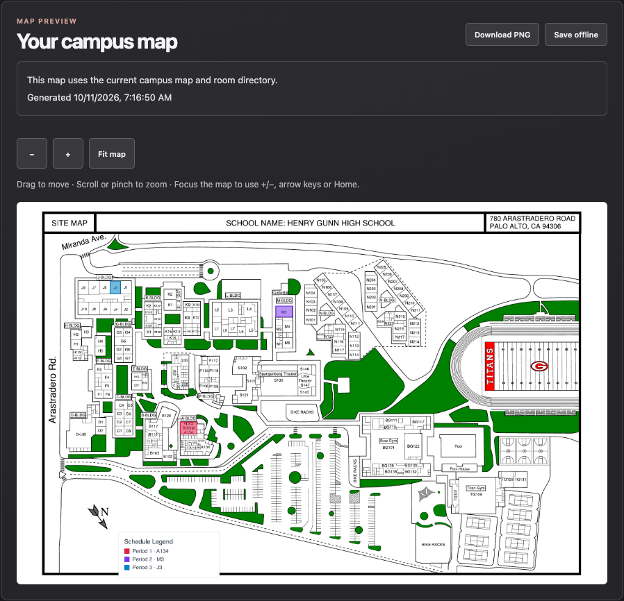
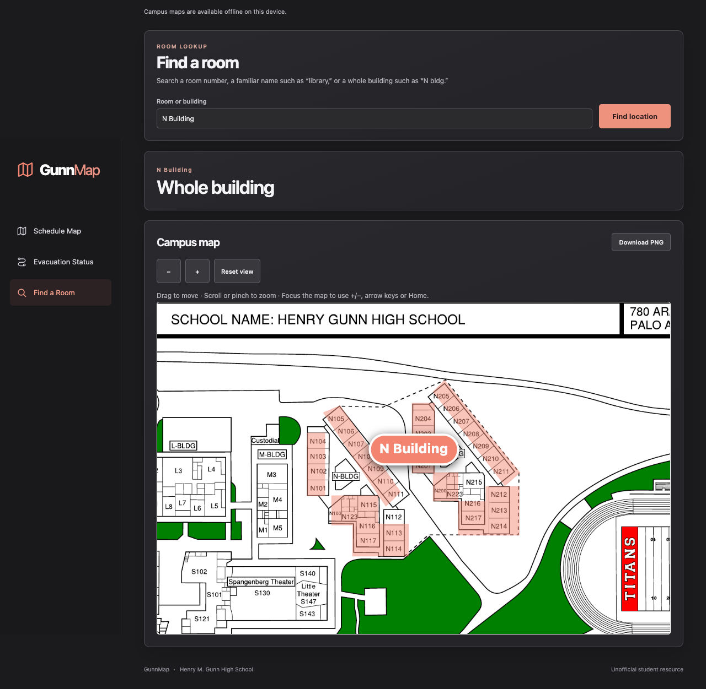

# GunnMap

GunnMap is an unofficial campus map for Henry M. Gunn High School. Enter a seven-period schedule to see its classrooms on a map, search for a room or whole building, and download a highlighted PNG.

The map uses the [September 3, 2026 district site map](https://resources.finalsite.net/images/v1788460107/pausdorg/fjembaqy0v2pmychgxlp/UpdatedGunncampusMap9-3-26.pdf). **It is not an evacuation plan:** routes and assembly assignments have not been verified. Follow school staff during an emergency.

**[Try the live site](https://xmccc-glitch.github.io/GunnMap/)** · The live GitHub Pages site is built from the separate `github-page-10/6` branch. It supports schedule maps and room search; changes on `main`, including whole-building search, do not appear there until that branch is updated.

| Generated schedule map | Whole-building search on `main` |
| --- | --- |
|  |  |

## What you can do

- **Map a schedule:** Enter up to seven rooms, choose colors, and generate a PNG with numbered period markers. Leave unused periods blank.
- **Find a place:** Search a room number, an alias such as `library`, or a building such as `N bldg` or `Bow Gym`. Choose a location if a room label is ambiguous.
- **Keep a schedule on this device:** Save drafts and templates, undo edits, and share a link that previews a schedule before replacing your own.
- **Check map provenance:** View the current campus map and the unconfirmed evacuation status separately from any saved classroom markers.

## Run locally

Requires Node.js 22.12 or newer and npm. From the GunnMap repository:

```sh
npm ci
npm run dev -- --port 8000
```

Open [http://127.0.0.1:8000](http://127.0.0.1:8000). You should see **Your schedule, on the map.** Enter `A134` in a period and select **Generate Map** to see a highlighted image below the editor. Or open **Find a Room** and search `N bldg` to highlight the building.

The server binds to `127.0.0.1` by default. `npm run dev` builds the browser app before starting the server; after later browser edits, run `npm run build:web` and reload, or restart the server. To run compiled server files, use `npm run build` followed by `npm start -- --port 8000`.

## Using the app

**Schedule Map** recognizes room labels and aliases despite differences in case, spaces, Unicode hyphens, or full-width characters. A recognized room selects its building. If a label has multiple matches, choose the intended location. **Generate Map** places the PNG below the editor, where you can zoom, download it, or save one personal map offline. Older `/generate-map` image links remain available.

**Find a Room** shows the map before a search. A room result includes its building, floor, and evacuation status; a building result highlights its full area. The building outlines include some approximate boundaries where the source map has no clear dividing line.

**Evacuation Status** displays the district site map and, if you have saved a schedule, markers for its classrooms. Those markers do not identify evacuation destinations. See [EVACUATION_REVIEW.md](EVACUATION_REVIEW.md) for the verification requirements.

Drafts and templates are stored in browser cookies on this device; GunnMap has no account or cloud schedule database. A share link carries schedule data in its URL fragment. Older saved room selections must be reviewed when the map or inventory changes.

### Optional Infinite Campus connection

Install the [GunnWatt Campus Connector](extension/README.md) in desktop Chrome or Edge, then choose **Connect Infinite Campus**. Sign in on the official school page. The extension reads the schedule and calendar on your device and stores a reduced import in this browser profile. GunnMap reads that saved copy on later visits; use **Update saved schedule** when your classes or responsive sessions change.

The import includes all available terms. PRIME, SELF, and Study Hall remain separate editable choices. The connector requires no Python service or remote sync backend. The website offers the ZIP download, and `npm run build:extension` builds it from source. Manual schedule entry works without the extension. Safari/iPad packaging is a separate distribution target.

### Offline and GitHub Pages

In the Node version on HTTPS or localhost, wait for **Campus maps are available offline on this device** before disconnecting. The map and room lookup can then work offline; generating a new image needs a connection. **Save offline** keeps one personal generated map, and **Download PNG** remains available for maps already on the device.

The Pages build renders schedule maps in the browser, without the Node API or server-side image store. It does not offer the Node version's personal-map offline save or service worker. To build a Pages artifact from the current checkout, run `npm run build:pages`; the deployment workflow publishes only pushes to `github-page-10/6`.

## Development

Room polygons and stable IDs are in `src/data/room_regions.json`; room labels and aliases are in `src/data/room_index.csv`; whole-building polygons and aliases are in `src/data/building_regions.json`. The map PDF and working images are in `src/map/`. Keep room IDs stable and use the [agent guide](AGENTS.md) for data and implementation rules.

The TypeScript map CLI can render room or building highlights:

```sh
npm run highlight -- --rooms output/rooms.png 'A134=#ff595e' 'B117=#1982c4'
npm run highlight -- output/buildings.png 'N=#ff595e'
```

The commands write PNGs to `output/`. Before a code change, run the relevant checks:

```sh
npm run typecheck
npm test
npm run build
```

`npm run build:pages` checks map data and builds the static site. The Node build also validates data. GitHub Actions runs type checks, a production build, and tests for pushes and pull requests.

## License

GunnMap is available under the [MIT License](LICENSE).
